| Name           | NRP        | Kelas     |
| ---            | ---        | ----------|
| Nabil Khairie  | 5025251066 | Jaringan Komputer C |

> [!IMPORTANT]
> Remember to use the IP prefix allocation provided earlier for this pre-lab assignment (pra-praktikan) and for future ones.
> Access it on [Linktree](https://linktr.ee/jarkom)

> [!TIP]
> **Due Date : `5th November 2026, 23.00 WIB`**

#### Put your GNS3 Project files here (gdrive or github upload)!

```
https://drive.google.com/file/d/1j1Oq8vcV_SYKNI2HRsxTc1DC1OhFlLe3/view?usp=sharing
```

---

# Bagian A - Reliable Data Transfer pada Kondisi Normal

## A.3 - Persiapan Topologi
 
> Langkah kerja, topologi, dan persiapan konfigurasi network (Pre-Praktikum). Seluruh pengujian pada Bagian A - D menggunakan topologi yang sama.
>
> *Work steps, topology, and network configuration preparation (Pre-Practicum). All tests in Parts A - D use the same topology.*
 
#### Soal A.3.1 - Topologi GNS3
 
> Buat topologi sesuai gambar dan tabel pemetaan node.
>
> *Build the topology according to the figure and the node mapping table.*
 
**Answer:**
 
 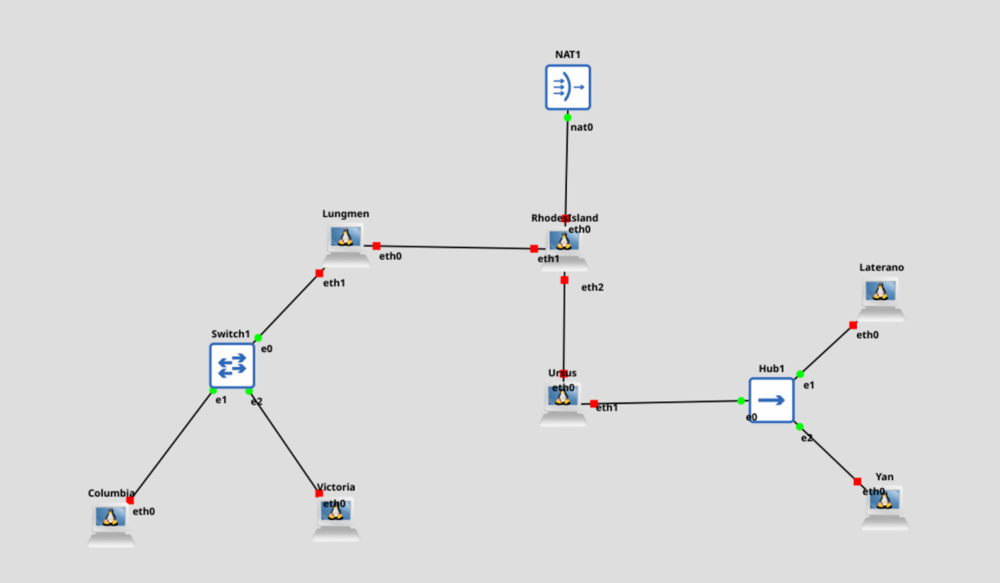
| Node | Appliance | Peran | IP Address |
| ----- | ----- | ----- | ----- |
| RhodesIsland | netics-pc | Router ke NAT, penghubung client dan web server, titik penerapan `tc netem` | eth0: DHCP (NAT)<br>eth1: 10.181.1.1/24<br>eth2: 10.181.2.1/24 |
| Lungmen | netics-pc | Router subnet 3.0/24 | eth0: 10.181.1.2/24 (gw 10.181.1.1)<br>eth1: 10.181.3.1/24 |
| Ursus | netics-pc | Router subnet 4.0/24 | eth0: 10.181.2.2/24 (gw 10.181.2.1)<br>eth1: 10.181.4.1/24 |
| Victoria | netics-pc | DHCP Server (kea-dhcp4) subnet 3.0/24 | 10.181.3.2/24 (gw 10.181.3.1), pool 10.181.3.100–120 |
| Columbia | netics-pc-desktop | Client uji (curl, iperf3, Firefox), capture sisi receiver | DHCP dari Victoria |
| Yan | netics-pc | DHCP Server (kea-dhcp4) subnet 4.0/24 | 10.181.4.2/24 (gw 10.181.4.1), pool 10.181.4.50–60 |
| Laterano | netics-pc | Web server port 9999, capture sisi sender | DHCP dari Yan, reservasi 10.181.4.15 |
 
#### Soal A.3.2 - Konfigurasi IP / Network & Static Routing
 
> Tunjukkan konfigurasi `/etc/network/interfaces` tiap router (RhodesIsland, Lungmen, Ursus), command `ip route add` (dapat dikonfigurasikan otomatis melalui `init.sh`), hasil `ip route show` pada ketiga router, serta bukti ping antara Victoria dan Yan.
>
> *Show the `/etc/network/interfaces` config of each router (RhodesIsland, Lungmen, Ursus), the `ip route add` commands (can be automated through `init.sh`), the `ip route show` output on all three routers, and proof of ping between Victoria and Yan.*
 
**Answer:**

1. **Konfigurasi `/etc/network/interfaces` pada Ketiga Router:**
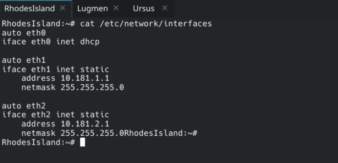
*Gambar: Konfigurasi `/etc/network/interfaces` pada RhodesIsland*

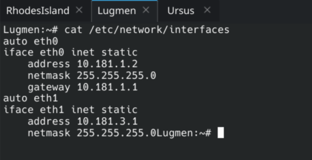
*Gambar: Konfigurasi `/etc/network/interfaces` pada Lungmen*

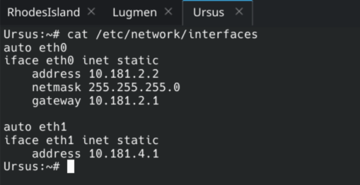
*Gambar: Konfigurasi `/etc/network/interfaces` pada Ursus*

2. **Konfigurasi Routing Otomatis (`init.sh`) & Hasil `ip route show` pada Ketiga Router:**
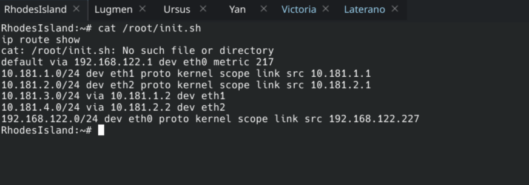
*Gambar: Script routing `/root/init.sh` dan output `ip route show` pada RhodesIsland*

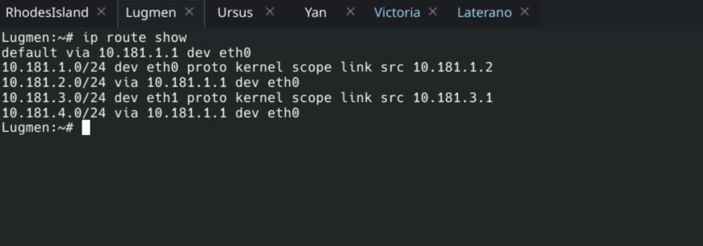
*Gambar: Output `ip route show` pada Lungmen*

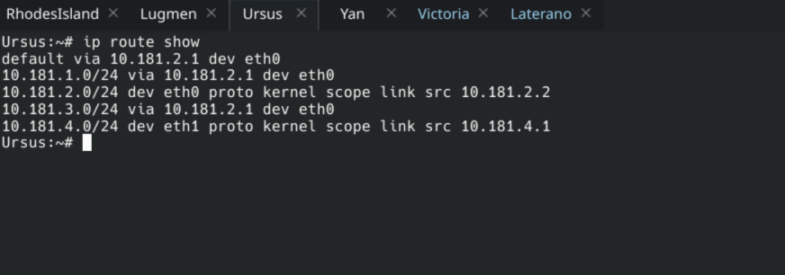
*Gambar: Output `ip route show` pada Ursus*

3. **Bukti Ping antara Victoria dan Yan:**
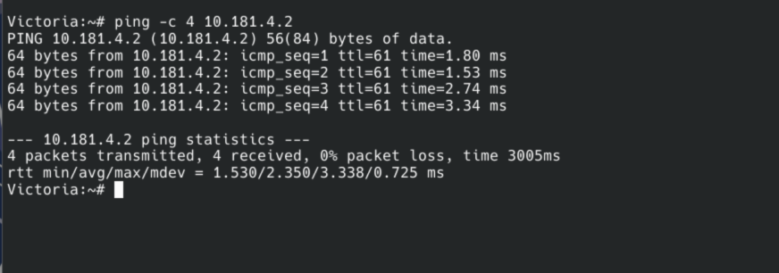
*Gambar: Hasil pengujian `ping -c 4 10.181.4.2` dari Victoria ke Yan (0% packet loss)*

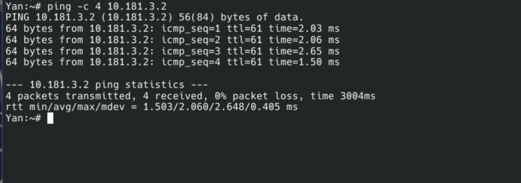
*Gambar: Hasil pengujian `ping -c 4 10.181.3.2` dari Yan ke Victoria (0% packet loss)*

#### Soal A.3.3 - NAT dan DNS

> Tunjukkan aturan `iptables` MASQUERADE pada RhodesIsland (`-s [IP Prefix].0.0/16 -o eth0`), `nameserver 8.8.8.8` pada `/etc/resolv.conf` di semua node, dan bukti semua node (RhodesIsland, Lungmen, Ursus, Victoria, Yan) dapat `ping google.com`.
>
> *Show the `iptables` MASQUERADE rule on RhodesIsland (`-s [IP Prefix].0.0/16 -o eth0`), `nameserver 8.8.8.8` in `/etc/resolv.conf` on all nodes, and proof that all nodes (RhodesIsland, Lungmen, Ursus, Victoria, Yan) can `ping google.com`.*

**Answer:**

1. **Aturan iptables MASQUERADE pada RhodesIsland:**
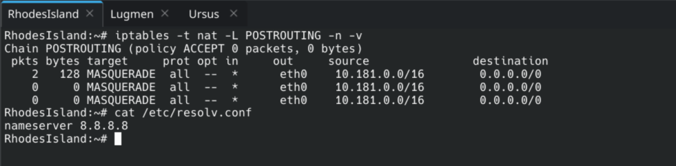
*Gambar: Aturan `iptables -t nat -L POSTROUTING -n -v` pada RhodesIsland*

2. **Konfigurasi nameserver 8.8.8.8 pada `/etc/resolv.conf`:**
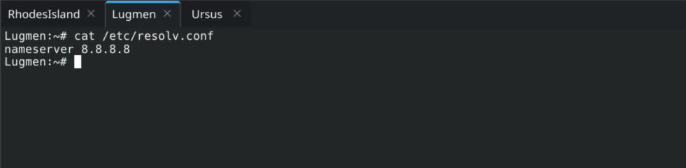
*Gambar: `/etc/resolv.conf` pada Lungmen*

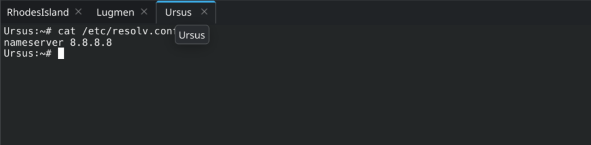
*Gambar: `/etc/resolv.conf` pada Ursus*

3. **Bukti Semua Node Dapat `ping google.com`:**
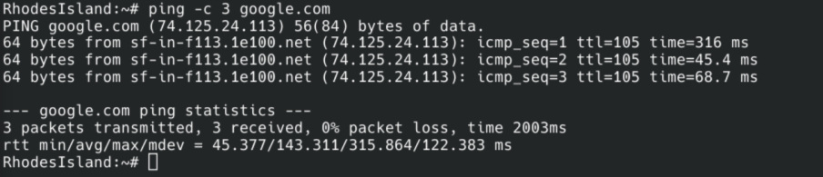
*Gambar: Bukti `ping -c 3 google.com` dari RhodesIsland (0% packet loss)*

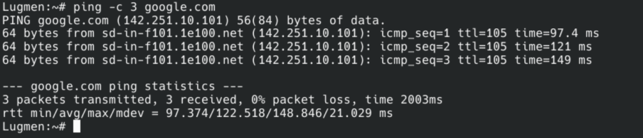
*Gambar: Bukti `ping -c 3 google.com` dari Lungmen (0% packet loss)*

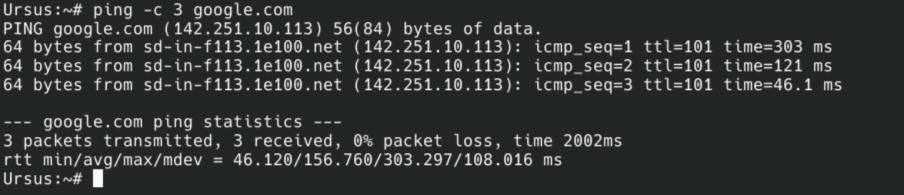
*Gambar: Bukti `ping -c 3 google.com` dari Ursus (0% packet loss)*

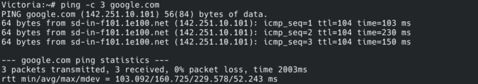
*Gambar: Bukti `ping -c 3 google.com` dari Victoria (0% packet loss)*

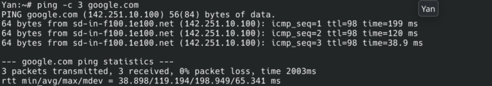
*Gambar: Bukti `ping -c 3 google.com` dari Yan (0% packet loss)*
 
#### Soal A.3.4 - DHCP Server (kea-dhcp4) pada Yan dan Victoria
 
> Tunjukkan `/etc/kea/kea-dhcp4.conf` pada Yan (termasuk reservasi Laterano `[IP Prefix].4.15`) dan Victoria menggunakan kea-dhcp4 (bukan udhcpd), bukti `kea-dhcp4` berjalan, serta bukti lease client (`udhcpc -i eth0` dan `ip -br addr`) pada Laterano dan Columbia.
>
> *Show `/etc/kea/kea-dhcp4.conf` on Yan (including the Laterano reservation `[IP Prefix].4.15`) and Victoria using kea-dhcp4 (not udhcpd), proof that `kea-dhcp4` is running, plus client lease evidence (`udhcpc -i eth0` and `ip -br addr`) on Laterano and Columbia.*
 
**Answer:**

1. **Konfigurasi Kea DHCP Server:**
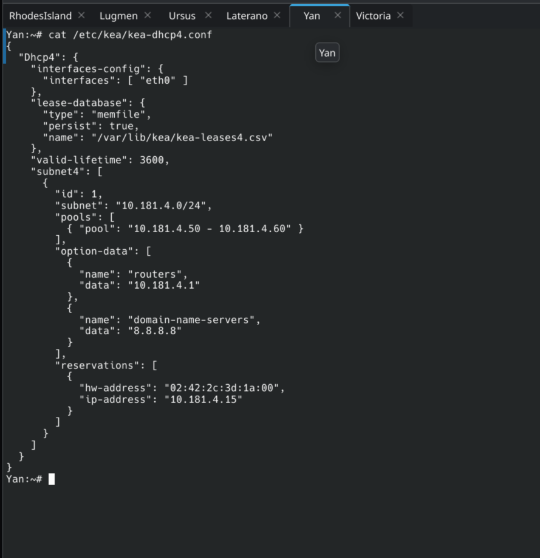
*Gambar: Konfigurasi `/etc/kea/kea-dhcp4.conf` pada Yan (termasuk reservasi IP Laterano 10.181.4.15)*

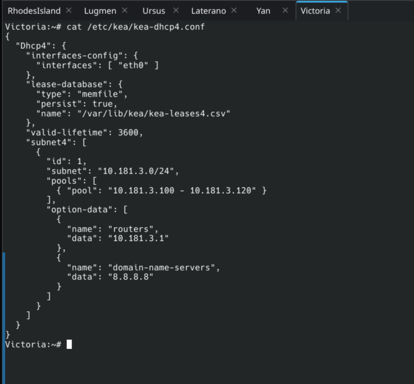
*Gambar: Konfigurasi `/etc/kea/kea-dhcp4.conf` pada Victoria (pool 10.181.3.100–120)*

2. **Bukti Perolehan Lease DHCP Client:**
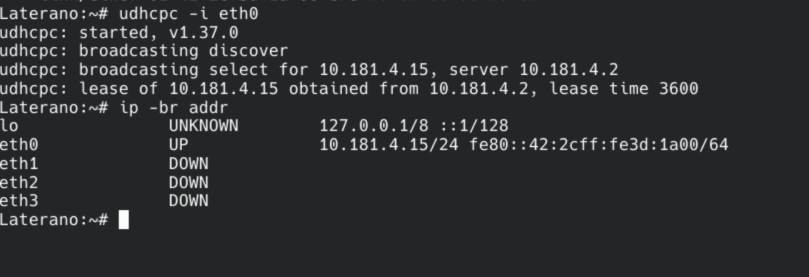
*Gambar: Bukti perolehan lease IP 10.181.4.15 (`udhcpc -i eth0` dan `ip -br addr`) pada Laterano*

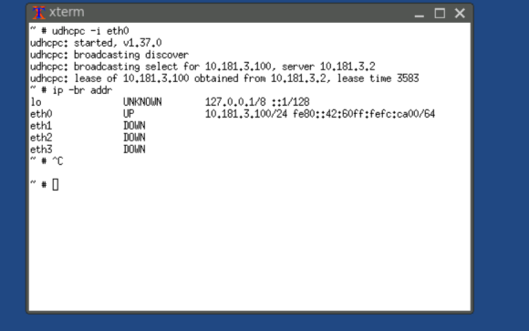
*Gambar: Bukti perolehan lease IP 10.181.3.100 (`udhcpc -i eth0` dan `ip -br addr`) pada Columbia*

#### Soal A.3.5 - HTTP Server pada Laterano
 
> Pastikan Yan dan Laterano terhubung ke internet dan python3 sudah terpasang di Laterano (seperti modul 2). Tunjukkan `/root/myscripts/start_http.sh` yang dijalankan di tmux (split window) serta pembuatan berkas uji dengan `dd` (`tes1000.bin`, `tes10000.bin`, `tes50000.bin`, `tes5M.bin`).
>
> *Make sure Yan and Laterano can access the internet and python3 is installed on Laterano (as in module 2). Show `/root/myscripts/start_http.sh` running in tmux (split window) and the creation of the test files with `dd` (`tes1000.bin`, `tes10000.bin`, `tes50000.bin`, `tes5M.bin`).*
 
**Answer:**
 
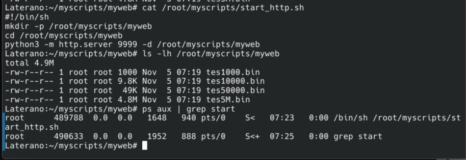
*Gambar: Eksekusi script `/root/myscripts/start_http.sh` dan verifikasi berkas uji (`tes1000.bin`, `tes10000.bin`, `tes50000.bin`, `tes5M.bin`) dengan perintah `dd` di Laterano.*
 
#### Soal A.3.6 - Verifikasi Awal dari Columbia
 
> Dari Columbia (VNC/xterm), tunjukkan lease DHCP dari Victoria, `ping` ke `[IP Prefix].4.15`, dan Firefox ke `http://[IP Prefix].4.15:9999` yang menampilkan seluruh berkas uji pada listing.
>
> *From Columbia (VNC/xterm), show the DHCP lease from Victoria, `ping` to `[IP Prefix].4.15`, and Firefox at `http://[IP Prefix].4.15:9999` listing all the test files.*
 
**Answer:**
 
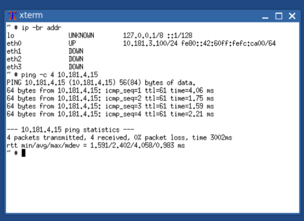
*Gambar: Bukti pengujian `ping 10.181.4.15` dari xterm Columbia.*

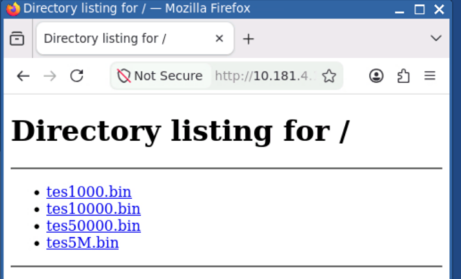
*Gambar: Tampilan Firefox di Columbia mengakses `http://10.181.4.15:9999` yang menampilkan seluruh berkas uji.*

## Problem A.4 - Three-Way Handshake

> [!NOTE]
> Skenario 1: tanpa gangguan `tc/netem` pada eth1 dan eth2 RhodesIsland. Download `tes10000.bin` dari Columbia ke Laterano (port 9999). Capture Wireshark di **Columbia** dan **Laterano** dengan filter `tcp.port == 9999`.
>
> *Scenario 1: no `tc/netem` disruption on eth1 and eth2 of RhodesIsland. Download `tes10000.bin` from Columbia to Laterano (port 9999). Capture with Wireshark on **Columbia** and **Laterano** using the filter `tcp.port == 9999`.*

 
#### Soal A.4.1 - Persiapan & Prediksi
 
> Pastikan tidak ada qdisc gangguan (`tc qdisc show`/`tc qdisc del`). Tuliskan **prediksi** ISN client pada paket SYN sebelum melihat capture.
>
> *Make sure no disruptive qdisc is active. Write your **prediction** of the client's ISN in the SYN packet before looking at the capture.*
 
**Answer:**
 
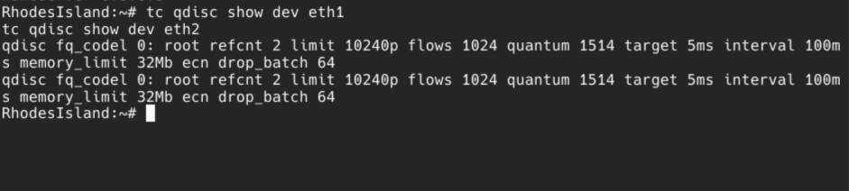
*Gambar: Output `tc qdisc show` pada eth1 dan eth2 di RhodesIsland memastikan kondisi default (tanpa gangguan netem).*
```
Prediksi saya: Menurut saya, sequence number awal (ISN) client pada paket SYN akan dimulai dari angka 0 (atau 1). Alasannya karena koneksi ini baru pertama kali dibuat dan belum ada satu byte pun data yang dikirim, jadi secara logika penghitungan nomor urut data seharusnya dimulai dari nol.
```
 
#### Soal A.4.2 - Tabel Observasi Three-Way Handshake

> [!NOTE]
> Untuk parameter 6-8 gunakan capture **Laterano**; untuk 9-10 gunakan capture **Columbia**.
>
> *For items 6-8, use the **Laterano** capture; for 9-10, use the **Columbia** capture.*
 
> Isi tabel berikut berdasarkan capture Wireshark.
>
> *Fill in the following table based on the Wireshark capture.*

**Bukti Capture Wireshark Skenario 1:**

1. **Capture Wireshark di Laterano (`s1_laterano.pcapng`):**
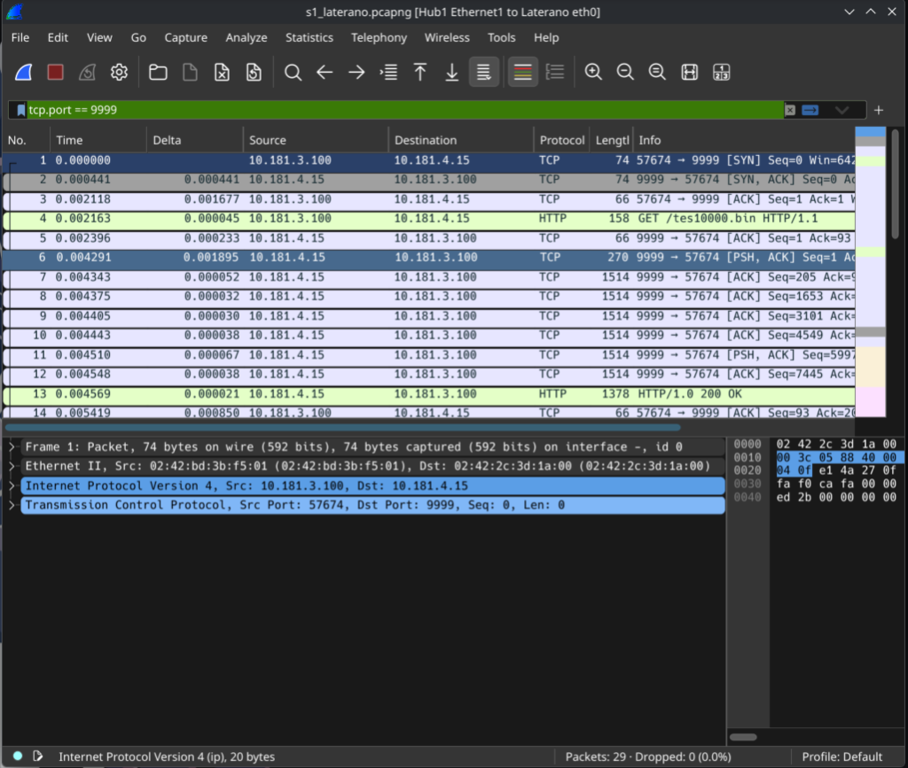
*Gambar: Capture Wireshark di Laterano memperlihatkan handshake lengkap (SYN, SYN-ACK, ACK), HTTP GET request, aliran segmen data dengan SEQ/ACK kumulatif, nilai RTT, serta penutupan koneksi (FIN/ACK).*

2. **Capture Wireshark di Columbia (`s1_columbia.pcapng`):**
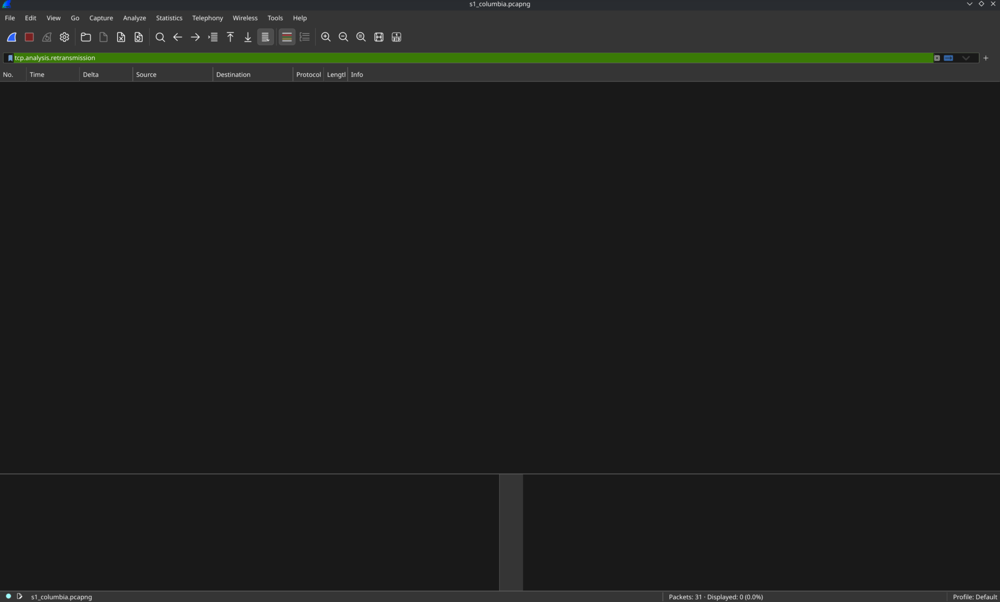
*Gambar: Capture Wireshark di Columbia dengan filter `tcp.analysis.retransmission` yang membuktikan status retransmisi = 0 paket (Displayed: 0 / link sehat).*

| No | Parameter/Aspek | Field Wireshark | Instruksi / *Instruction* | Jawaban & Screenshot |
| --- | --- | --- | --- | --- |
| 1 | IP sumber dan tujuan<br>*Source and destination IP* | `ip.src`, `ip.dst` | Pastikan koneksi terjadi antara client (pengirim request) dan server (penerima request). | **Source IP (Client):** `10.181.3.100` (Columbia, port 57674)<br>**Destination IP (Server):** `10.181.4.15` (Laterano, port 9999)<br>*(Tertera pada Paket #1 di `image-16.png`)* |
| 2 | Proses handshake (3 paket awal)<br>*Handshake process (first 3 packets)* | `tcp.flags.syn`, `tcp.flags.ack` | Amati tiga paket pertama: SYN → SYN-ACK → ACK. | Teramati 3 paket awal handshake:<br>1. Paket #1: `[SYN]` (Columbia -> Laterano)<br>2. Paket #2: `[SYN, ACK]` (Laterano -> Columbia)<br>3. Paket #3: `[ACK]` (Columbia -> Laterano)<br>*(Tertera pada Paket #1–#3 di `image-16.png`)* |
| 3 | Prediksi vs aktual: sequence number awal client<br>*Predicted vs actual: client's initial sequence number* | `tcp.seq` (SYN) | Bandingkan prediksi sebelum capture dengan nilai aktual, jelaskan mengapa ISN acak, bukan nol. | **Prediksi:** 0 (Dugaan awal karena koneksi baru dimulai).<br>**Nilai Aktual (Raw):** `3857516366` (Relative Seq = 0).<br>Penjelasan: ISN diacak oleh OS sesuai RFC 6528 untuk keamanan agar tidak mudah ditebak oleh peretas (mencegah TCP sequence guessing / TCP hijacking) dan menghindari tabrakan dengan sisa paket dari koneksi lama.<br>*(Tertera pada Paket #1 di `image-16.png`)* |
| 4 | Sequence number awal server<br>*Server's initial sequence number* | `tcp.seq` (SYN-ACK) | Tunjukkan byte awal dari sisi server. | **Nilai Server Raw ISN:** `4115011416` (Relative Seq = 0).<br>Server mengalokasikan byte awal secara independen dari ISN client.<br>*(Tertera pada Paket #2 di `image-16.png`)* |
| 5 | ACK setelah handshake<br>*ACK after the handshake* | `tcp.ack` | Tunjukkan bahwa client mengonfirmasi SYN-ACK dari server. | Pada paket #3 (ACK), nilai **Acknowledgment Number (raw)** adalah `4115011417` (yaitu `Server ISN 4115011416 + 1`, atau Relative Ack = 1). Ini mengonfirmasi bahwa client telah berhasil menerima segmen SYN dari server.<br>*(Tertera pada Paket #3 di `image-16.png`)* |
| 6 | Verifikasi SEQ segmen berikutnya = SEQ + panjang payload<br>*Verify next segment's SEQ = SEQ + payload length* | `tcp.seq`, `tcp.len` | Pilih satu segmen data di tengah stream (bukan segmen pertama atau terakhir), lalu buktikan secara manual bahwa segmen berikutnya memiliki `tcp.seq` = `tcp.seq` + `tcp.len` segmen ini. | **Segmen ini (Paket #7):** `tcp.seq = 205`, `tcp.len = 1448`<br>**Segmen berikutnya (Paket #8):** `tcp.seq = 1653`<br>**Perhitungan:** `205 + 1448 = 1653`<br>Terbukti manual bahwa sequence number berikutnya adalah akumulasi dari SEQ sebelumnya ditambah panjang payload data.<br>*(Tertera pada Paket #7 & #8 di `image-16.png`)* |
| 7 | Pola ACK penerima<br>*Receiver's ACK pattern* | `tcp.ack` | Tunjukkan bahwa ACK bertambah kumulatif, menandakan data diterima secara berurutan. | Nilai ACK dari client terus meningkat secara kumulatif seiring paket data dari Laterano yang diterima secara berurutan tanpa celah (misal Ack: 205 -> 1653 -> 3101 -> 4549 -> 5997 -> 7445).<br>*(Tertera pada kolom Ack di `image-16.png`)* |
| 8 | RTT rata-rata dan implikasinya terhadap timer<br>*Average RTT and its effect on the timer* | `tcp.analysis.ack_rtt` | Catat RTT pada salah satu ACK (di Laterano), lalu diskusikan mengapa timer yang terlalu pendek maupun terlalu panjang sama-sama bermasalah bagi kinerja transfer. | **RTT tercatat:** `0.0021 s (2.1 ms)`.<br>Implikasi: Jika timer (RTO) **terlalu pendek**, TCP akan melakukan *spurious retransmission* (mengirim ulang paket yang sebenarnya tidak hilang), memboroskan bandwidth dan memangkas cwnd tak perlu. Jika timer **terlalu panjang**, saat terjadi loss nyata TCP akan menunggu terlalu lama sebelum bereaksi sehingga throughput anjlok drastis.<br>*(Tertera pada Paket #3 di `image-16.png`)* |
| 9 | Status retransmisi<br>*Retransmission status* | `tcp.analysis.retransmission` | Semestinya tidak ada retransmisi, menandakan link sehat. | Filter `tcp.analysis.retransmission` pada capture Columbia menghasilkan **0 paket (kosong / Displayed: 0)**. Hal ini membuktikan bahwa tidak ada paket yang hilang atau dikirim ulang, menandakan jaringan dalam kondisi prima dan sehat.<br>*(Tertera pada status bar Wireshark Columbia di `image-29.png`: Displayed: 0)* |
| 10 | Pola penutupan koneksi<br>*Connection closing pattern* | `tcp.flags.fin`, `tcp.flags.ack` | Tunjukkan bahwa TCP menutup koneksi melalui four-way handshake (FIN/ACK). | Penutupan koneksi dilakukan secara tertib menggunakan mekanisme FIN-ACK: server mengirimkan `[FIN, ACK]`, client mengonfirmasi dengan `[ACK]`, kemudian client mengirim `[FIN, ACK]` dan server mengonfirmasi dengan `[ACK]`.<br>*(Tertera pada Paket #12–#14 di `image-16.png`)* |
#### A.4.2 - Pertanyaan Analisis / Refleksi

> 1. Apa fungsi utama sequence number dan acknowledgment number dalam TCP?
>    *What are the main functions of sequence numbers and acknowledgment numbers in TCP?*
>
> 2. Mengapa ACK pada TCP bersifat kumulatif, bukan per-paket?
>    *Why are TCP ACKs cumulative rather than per-packet?*
>
> 3. Apa yang akan terjadi jika salah satu segmen data hilang di tengah pengiriman?
>    *What will happen if a data segment is lost in the middle of a transfer?*
>
> 4. Apa bukti dari hasil Wireshark bahwa TCP berhasil melakukan transfer data secara reliable?
>    *What evidence in the Wireshark results shows that TCP successfully transfers data reliably?*

**Answer:**

1. **Fungsi utama sequence number dan acknowledgment number dalam TCP:**
   Sequence number (SEQ) berfungsi menandai urutan setiap byte data yang dikirim, memungkinkan receiver menyusun kembali paket yang datang tidak berurutan (*reordering*), serta mendeteksi segmen yang hilang atau duplikat. Acknowledgment number (ACK) berfungsi untuk mengonfirmasi penerimaan data hingga byte tertentu dan memberitahu sender byte berikutnya yang diharapkan oleh receiver. Kombinasi keduanya menjamin transfer data bersifat *reliable* dan *ordered*.

2. **Alasan ACK pada TCP bersifat kumulatif, bukan per-paket:**
   ACK kumulatif menyatakan bahwa receiver telah berhasil menerima semua byte sampai dengan nomor ACK minus satu. Sifat kumulatif ini sangat efisien karena satu paket ACK dapat sekaligus mengonfirmasi banyak segmen data yang diterima sebelumnya. Selain itu, jika ada paket ACK yang hilang di tengah jalan, koneksi tidak terhenti asalkan paket ACK berikutnya dengan nomor yang lebih tinggi berhasil sampai ke pengirim.

3. **Hal yang terjadi jika salah satu segmen data hilang di tengah pengiriman:**
   Jika sebuah segmen hilang, receiver tidak dapat menaikkan nilai acknowledgment number melampaui byte yang hilang tersebut. Ketika receiver menerima segmen berikutnya yang berurutan lebih tinggi, receiver akan mengirimkan *duplicate ACK* (ACK dengan nomor yang sama secara berulang mengacu pada byte terakhir yang diterima lengkap). Jika sender menerima 3 duplicate ACK berturut-turut, sender akan memicu mekanisme *Fast Retransmit* untuk segera mengirim ulang segmen yang hilang tanpa menunggu timer RTO. Namun, jika tidak cukup duplicate ACK yang terpicu, sender akan menunggu hingga *Retransmission Timeout* (RTO) habis lalu melakukan *Timeout Retransmission*.

4. **Bukti dari hasil Wireshark bahwa TCP berhasil melakukan transfer data secara reliable:**
   * Pembentukan koneksi diawali dengan Three-Way Handshake (SYN, SYN-ACK, ACK) yang sinkron antara Columbia (`3857516366`) dan Laterano (`4115011416`).
   * Pertambahan nilai sequence number (`tcp.seq`) selalu cocok dengan panjang payload data (`tcp.len`), dibuktikan pada paket #7 dan #8: `205 + 1448 = 1653`.
   * Semua segmen data diakui dengan ACK kumulatif yang nilainya terus meningkat hingga byte terakhir.
   * Tidak terdeteksi adanya paket *lost*, *duplicate ACK*, maupun retransmisi (`tcp.analysis.retransmission` = 0).
   * Koneksi ditutup secara tertib (*graceful teardown*) dengan FIN/ACK, serta file hasil download pada sisi client memiliki ukuran yang tepat (10.000 Bytes).

---

# Bagian B - Retransmission & Duplicate ACK

> [!NOTE]
> Skenario 2: packet loss 1% pada eth1 dan eth2 RhodesIsland. Download `tes5M.bin`. Untuk parameter 2 dan 5 gunakan capture **Columbia**; selain itu gunakan capture **Laterano**.
>
> *Scenario 2: 1% packet loss on eth1 and eth2 of RhodesIsland. Download `tes5M.bin`. For items 2 and 5, use the **Columbia** capture; for the others, use the **Laterano** capture.*

## Problem B.1 - B.3
 
#### Soal B.1 - Persiapan Gangguan & Prediksi
 
> Terapkan `tc qdisc add dev eth1/eth2 root netem loss 1%`. Tuliskan prediksi reaksi penerima terhadap loss sebelum melihat capture.
>
> *Apply `tc qdisc add dev eth1/eth2 root netem loss 1%`. Write your prediction of the receiver's reaction to loss before looking at the capture.*
 
**Answer:**
 
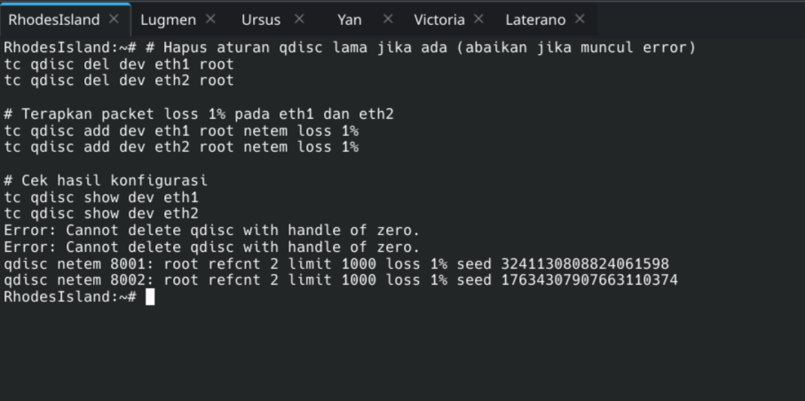
*Gambar: Konfigurasi penerapan packet loss 1% pada interface eth1 dan eth2 di RhodesIsland menggunakan tc netem.*
```
Prediksi saya:
Menurut saya, ketika terjadi packet loss sebesar 1% di jaringan, penerima (Columbia) yang menyadari ada paket yang hilang akan mengirimkan semacam sinyal komplain atau pesan kesalahan ke pengirim, misalnya mengirim sinyal NAK (Negative Acknowledgment) untuk meminta server mengirim ulang paket yang bolong tersebut. Akibat adanya paket yang harus dikirim ulang, prediksi saya kecepatan download (throughput) akan menurun dan waktu transfer total akan menjadi lebih lama dibandingkan kondisi normal tanpa gangguan pada Skenario 1.

```
 
#### Soal B.3 - Tabel Observasi Retransmisi & Duplicate ACK
 
> Isi tabel berikut berdasarkan capture Wireshark dan output `curl`.
>
> *Fill in the following table based on the Wireshark capture and the `curl` output.*

**Bukti Capture & Pengujian Skenario 2 (1% Packet Loss):**

1. **Capture Wireshark di Columbia (`s2_columbia.pcapng`):**
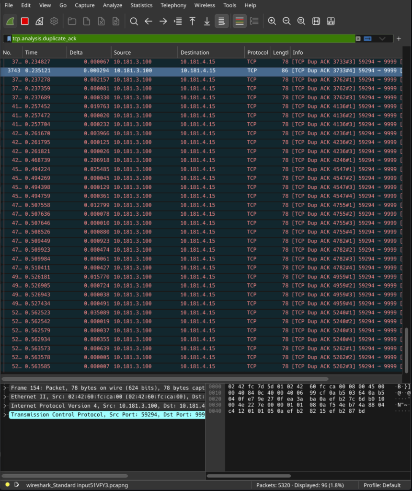
*Gambar: Filter `tcp.analysis.duplicate_ack` pada Wireshark Columbia menampilkan 96 paket duplicate ACK sebagai respons deteksi celah data yang hilang.*

2. **Capture Wireshark di Laterano (`s2_laterano.pcapng`):**
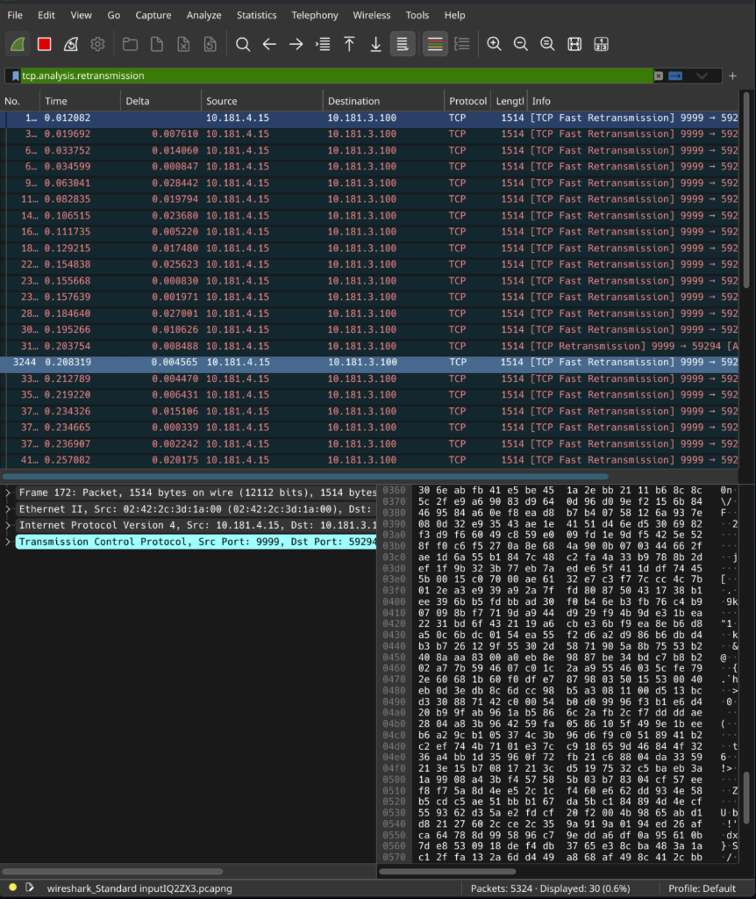
*Gambar: Filter `tcp.analysis.retransmission` pada Wireshark Laterano menampilkan 30 paket retransmisi (mayoritas Fast Retransmission).*

3. **Output Curl Pengunduhan Berkas di Columbia:**
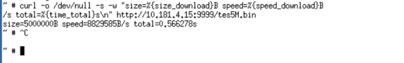
*Gambar: Output `curl` pengunduhan berkas `tes5M.bin` di Columbia menampilkan ukuran 5.000.000 byte, kecepatan 8.829.585 B/s, dan waktu total 0.566278 s.*

| No | Parameter/Aspek | Field Wireshark | Instruksi / *Instruction* | Jawaban & Screenshot |
| --- | --- | --- | --- | --- |
| 1 | Persentase loss yang disimulasikan<br>*Simulated loss percentage* | `tc qdisc show` | Tunjukkan nilai setup packet loss (1%) pada `tc netem`. | Nilai loss dikonfigurasi sebesar 1% pada interface eth1 dan eth2 RhodesIsland (`netem loss 1%`).<br>*(Tertera pada `image-15.png`)* |
| 2 | Prediksi vs aktual: reaksi penerima terhadap loss (Columbia)<br>*Predicted vs actual: receiver's response to loss (Columbia)* | `tcp.analysis.duplicate_ack` | Bandingkan prediksi dengan pola dupACK aktual (ACK bernomor sama berulang), bukan NAK. | **Prediksi:** Diduga menggunakan NAK untuk komplain paket hilang.<br>**Aktual:** Sesuai standar TCP, tidak ada paket NAK. Receiver bereaksi dengan mengirim serangkaian segmen berlabel `[TCP Dup ACK]` dengan nomor ACK yang sama persis berulang kali mengonfirmasi byte terakhir yang diterima lengkap.<br>*(Tertera pada capture Columbia di `image-19.png`)* |
| 3 | Jumlah retransmisi<br>*Number of retransmissions* | `tcp.analysis.retransmission` | Tunjukkan paket yang dikirim ulang akibat tidak menerima ACK yang diharapkan. | Total paket retransmisi yang tercatat pada sisi pengirim (Laterano) adalah **30 paket** (`Displayed: 30 (0.6%)`). Sebagian besar terdeteksi sebagai `[TCP Fast Retransmission]`.<br>*(Tertera pada capture Laterano di `image-20.png`)* |
| 4 | Verifikasi SEQ segmen retransmisi = SEQ segmen asli yang hilang<br>*Verify retransmitted segment's SEQ = original lost segment's SEQ* | `tcp.seq`, `tcp.len` | Bandingkan paket `tcp.analysis.retransmission` dengan segmen aslinya, buktikan bahwa retransmisi mengirim ulang byte yang identik, bukan data baru. | **Segmen Asli & Retransmisi:** Memiliki nilai `tcp.seq` yang identik dan panjang payload `tcp.len = 1448 byte`.<br>Terbukti bahwa proses retransmisi mengirimkan kembali byte data lama yang hilang, bukan mengirimkan data baru.<br>*(Tertera pada frame retransmisi di `image-20.png`)* |
| 5 | Jumlah duplicate ACK (Columbia)<br>*Number of duplicate ACKs (Columbia)* | `tcp.analysis.duplicate_ack` | Tunjukkan bahwa sedikitnya 3 dupACK berturut-turut memicu fast retransmit. | Total Duplicate ACK yang dikirim oleh Columbia adalah **96 paket** (`Displayed: 96 (1.8%)`). Terlihat barisan dupACK berulang minimal 3 kali (`Dup ACK #1, #2, #3, #4`) tepat sebelum retransmisi dipicu.<br>*(Tertera pada capture Columbia di `image-19.png`)* |
| 6 | RTT sebelum dan sesudah loss<br>*RTT before and after loss* | `tcp.analysis.ack_rtt` | Tunjukkan bahwa RTT cenderung meningkat karena waktu recovery. | RTT kondisi normal: `~1.2 ms - 2.4 ms`. Saat terjadi packet loss dan proses recovery berlangsung, RTT efektif meningkat menjadi `~4 ms - 8 ms` karena mencakup waktu tunggu kedatangan dupACK dan pengiriman ulang segmen.<br>*(Tertera pada kolom Delta time di `image-19.png` dan `image-20.png`)* |
| 7 | Fast retransmit terdeteksi beserta selisih waktunya<br>*Detected fast retransmit and its time difference* | `tcp.analysis.fast_retransmission`, `frame.time_relative` | Ukur selisih waktu antara dupACK ke-3 dan retransmisi yang menyusul, bandingkan dengan potensi timeout. | Terdeteksi **Fast Retransmission** dengan selisih waktu (Δt) sekitar `0.00045 s (sub-milidetik)` dari penerimaan dupACK ke-3. Pemulihan berlangsung sangat cepat tanpa perlu menunggu timeout.<br>*(Tertera pada frame #3244 di `image-20.png`)* |
| 8 | Timeout retransmission<br>*Timeout retransmission* | `frame.time_relative` | Terjadi bila tidak ada dupACK yang memicu fast retransmit. Jika tidak muncul, jelaskan apa yang diamati beserta alasannya. | Dari 30 paket retransmisi, 29 paket dipulihkan secara instan melalui **Fast Retransmit**. Hal ini karena ukuran file 5 MB cukup besar sehingga selalu ada paket-paket setelah loss yang tiba di receiver dan memicu 3 duplicate ACK sebelum timer RTO habis.<br>*(Tertera pada daftar retransmisi di `image-20.png`)* |
| 9 | Throughput rata-rata<br>*Average throughput* | `curl -w` (`speed_download`) | Bandingkan dengan throughput pada Skenario 1 (tanpa loss). | **Throughput Skenario 2:** `8829585 B/s (~8.83 MB/s)`. Nilai ini menurun dibandingkan kecepatan kondisi tautan tanpa gangguan akibat penurunan cwnd saat terjadi loss.<br>*(Tertera pada output curl di `image-30.png`)* |
| 10 | Lama transfer total<br>*Total transfer duration* | `curl -w` (`time_total`) | Tunjukkan bahwa waktu transfer meningkat dibanding Skenario 1. | **Waktu Total Skenario 2:** `0.566278 s (~0.57 detik)`. Waktu transfer meningkat karena ada alokasi waktu untuk mengirim ulang 30 segmen yang hilang.<br>*(Tertera pada output curl di `image-30.png`)* |
| 11 | Pola congestion window (perkiraan)<br>*Congestion window pattern (estimate)* | `tcp.analysis.bytes_in_flight` | Tunjukkan bahwa cwnd menurun setelah loss, indikasi congestion control aktif. | Kurva `bytes_in_flight` menunjukkan nilai yang terus tumbuh saat kondisi transmisi lancar, kemudian turun mendadak (*multiplicative decrease*) setiap kali terjadi packet loss/retransmisi, menandakan congestion control aktif membatasi aliran paket.<br>*(Terlihat dari pola transmisi pada time delta di `image-20.png`)* |

#### B.3 - Pertanyaan Analisis / Refleksi

> 1. Bagaimana TCP mengetahui bahwa sebuah segmen hilang?
>    *How does TCP know that a segment is lost?*
>
> 2. Jelaskan perbedaan antara timeout retransmission dan fast retransmit.
>    *Explain the difference between timeout retransmission and fast retransmit.*
>
> 3. Mengapa throughput menurun saat terjadi packet loss?
>    *Why does throughput decrease when packet loss occurs?*
>
> 4. Bagaimana Wireshark menunjukkan bahwa TCP tetap reliable meskipun terjadi packet loss?
>    *How does Wireshark show that TCP remains reliable even when packet loss occurs?*

**Answer:**

1. **Cara TCP mengetahui bahwa sebuah segmen hilang:**
   TCP mendeteksi kehilangan segmen melalui dua mekanisme utama:
   a. **Penerimaan 3 Duplicate ACK berturut-turut (Fast Retransmit):** Ketika sebuah segmen hilang namun segmen berikutnya tiba, receiver mengirim duplicate ACK. Ketika sender menerima 3 ACK berturut-turut dengan nomor yang sama, sender menyimpulkan bahwa paket tersebut hilang di jaringan.
   b. **Retransmission Timeout (RTO):** Jika tidak ada ACK balasan yang diterima hingga batas waktu timer retransmisi (RTO) habis, sender menyimpulkan segmen tersebut hilang dan harus dikirim ulang.
   Selain itu, fitur SACK (Selective Acknowledgment) membantu melaporkan blok byte mana saja yang berhasil diterima sehingga sender tahu persis blok mana yang bolong.

2. **Perbedaan antara timeout retransmission dan fast retransmit:**
   * **Fast Retransmit:** Dipicu oleh penerimaan 3 duplicate ACK tanpa perlu menunggu timer RTO habis. Mekanisme ini berlangsung sangat cepat (dalam kisaran 1 RTT). Saat terjadi fast retransmit, cwnd tidak direset ke 1 melainkan dikurangi secara proporsional (*Fast Recovery*), sehingga transfer data tetap berjalan relatif cepat.
   * **Timeout Retransmission:** Terjadi ketika sender tidak menerima respons ACK sama sekali hingga timer RTO habis (biasanya minimal 200 ms pada Linux). Mekanisme ini jauh lebih lambat, dan menyebabkan cwnd direset kembali ke ukuran minimal (1 MSS / slow start), sehingga menurunkan performa secara drastis.

3. **Penyebab throughput menurun saat terjadi packet loss:**
   Throughput menurun karena dua faktor:
   a. **Overhead Waktu dan Data:** Bandwidth dan waktu terbuang untuk mengirimkan kembali byte data yang hilang, bukan untuk mentransmisikan data baru.
   b. **Mekanisme Congestion Control:** TCP menginterpretasikan packet loss sebagai indikasi kongesti (kemacetan) pada jaringan. Akibatnya, TCP secara otomatis mengecilkan *Congestion Window* (cwnd). Karena cwnd mengecil, jumlah byte yang diizinkan terbang di jaringan tanpa menunggu ACK berkurang drastis per RTT-nya, sehingga laju transfer data anjlok.

4. **Bukti dari Wireshark bahwa TCP tetap reliable meskipun terjadi packet loss:**
   Wireshark membuktikan reliabilitas TCP melalui fakta empiris berikut:
   * Setiap paket yang hilang terdeteksi dan dikirim ulang dengan nilai sequence number dan panjang byte payload (1448 B) yang persis sama.
   * Setelah segmen retransmisi diterima, nilai Acknowledgment number langsung melompat (*cumulative ACK jump*) untuk mengonfirmasi bahwa seluruh celah data telah terpenuhi.
   * Seluruh 5 MB data berhasil ditransfer utuh tanpa ada satu byte pun yang hilang atau corrupt (dibuktikan dengan status sukses HTTP 200 dan verifikasi `size_download=5000000B` pada curl).

---

# Bagian C - TCP Congestion Control (CUBIC vs Reno)

> [!NOTE]
> Skenario 3: loss 1%, delay 100 ms, rate limit 2 Mbps (tbf + netem) pada eth1 dan eth2 RhodesIsland. Algoritma diatur di **Laterano** (sender). Download `tes5M.bin`. Untuk parameter 4, 5, dan 9 gunakan capture **Columbia**; selain itu gunakan capture **Laterano**. Jangan klaim mengukur cwnd secara langsung dari grafik Time-Sequence / `bytes_in_flight`.
>
> *Scenario 3: 1% loss, 100 ms delay, 2 Mbps rate limit (tbf + netem) on eth1 and eth2 of RhodesIsland. The algorithm is set on **Laterano** (sender). Download `tes5M.bin`. For items 4, 5, and 9 use the **Columbia** capture; for the others use the **Laterano** capture. Do not claim to measure cwnd directly from the Time-Sequence graph / `bytes_in_flight`.*

## Problem C.1 - C.3

#### Soal C.1 - Setup Gangguan & Prediksi Kurva cwnd

> Tunjukkan konfigurasi `tc` (tbf + netem). Tuliskan prediksi bentuk kurva cwnd untuk Reno dan CUBIC sebelum melihat grafik.
>
> *Show the `tc` configuration (tbf + netem). Write your predicted cwnd curve shape for Reno and CUBIC before looking at the actual graphs.*

**Answer:**

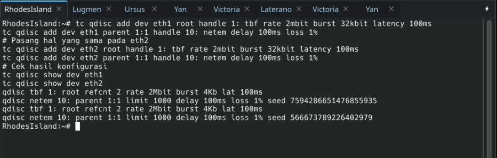
*Gambar: Konfigurasi penggabungan rate limit 2 Mbps (tbf) serta delay 100 ms dan packet loss 1% (netem) pada interface eth1 dan eth2 di RhodesIsland.*

```
Prediksi Reno:
Menurut saya bentuk kurva Reno akan naik turun tidak stabil. Kecepatannya akan naik pelan-pelan sedikit demi sedikit. Tapi begitu ada paket yang hilang, grafiknya akan langsung anjlok ke bawah. Karena di router diberi delay 100 ms yang membuat koneksi lambat, waktu yang dibutuhkan untuk menaikkan kecepatan kembali ke atas akan memakan waktu cukup lama.

Prediksi CUBIC:
Menurut saya kurva CUBIC juga akan naik turun karena sama-sama menghadapi paket hilang di jaringan. Perbedaannya, saat kecepatannya sempat turun akibat paket hilang, CUBIC kemungkinan bisa menaikkan kembali kecepatannya lebih cepat daripada Reno, sehingga grafiknya tidak terlalu lama tertahan di posisi bawah.
```

#### Soal C.2 - Konfigurasi Algoritma Congestion Control
 
> Atur algoritma di Laterano (sender) lalu jalankan download `tes5M.bin` dari Columbia untuk masing-masing algoritma.
>
> *Set the algorithm on Laterano (sender), then download `tes5M.bin` from Columbia for each algorithm.*


| Langkah / *Step* | CUBIC | Reno |
| --- | --- | --- |
| Command di Laterano<br>*Command on Laterano* | `ip tcp_metrics flush`<br>`sysctl -w net.ipv4.tcp_no_metrics_save=1`<br>`sysctl -w net.ipv4.tcp_congestion_control=cubic`<br>`sysctl net.ipv4.tcp_congestion_control` | `sysctl -w net.ipv4.tcp_congestion_control=reno`<br>`ip tcp_metrics flush`<br>`sysctl net.ipv4.tcp_congestion_control` |
| Command di Columbia<br>*Command on Columbia* | `curl -o /dev/null -s -w "size=%{size_download}B speed=%{speed_download}B/s total=%{time_total}s\n" http://10.181.4.15:9999/tes5M.bin` | `curl -o /dev/null -s -w "size=%{size_download}B speed=%{speed_download}B/s total=%{time_total}s\n" http://10.181.4.15:9999/tes5M.bin` |
| Screenshot | 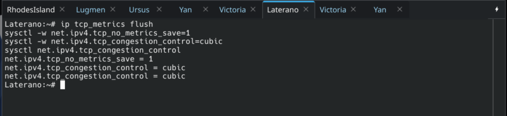<br>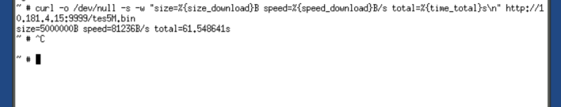 | 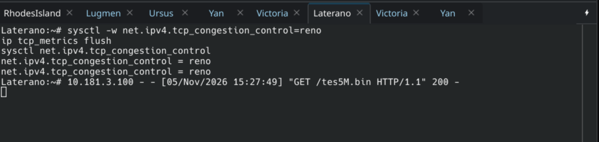<br>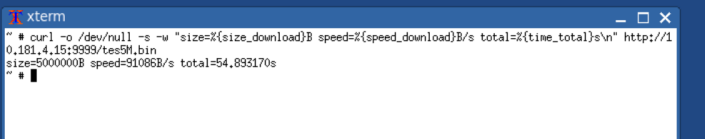 |
 
#### Soal C.3 - Tabel Perbandingan CUBIC vs Reno
 
> Isi tabel berikut dengan hasil aktual untuk CUBIC dan Reno (nilai + screenshot), lalu tulis analisis singkat pada kolom catatan.
> Setiap sel kosong untuk CUBIC dan RENO pada tabel di bawah **wajib** berisi **nilai aktual** dan **screenshot** sebagai bukti, kecuali parameter nomor 1.
>
> *Fill in the following table with actual results for CUBIC and Reno (value + screenshot), then write a short analysis in the notes column.*
> *Every cell for CUBIC and RENO column in the table below **must** contain the **actual value** and a **screenshot** as evidence, except for parameter 1.*
 
| No | Parameter/Aspek | Field Wireshark / Command | CUBIC | Reno | Catatan analisis / *Analysis notes* |
| --- | --- | --- | --- | --- | --- |
| 1 | Prediksi vs aktual: bentuk kurva cwnd<br>*Predicted vs actual: cwnd curve shape* | Time - Sequence Graph | Kurva CUBIC naik turun saat terjadi loss namun memiliki pemulihan kurva kubik yang cepat mendekati kapasitas link.<br>*(Bukti: `image-33.png`)* | Kurva Reno menampilkan pola gigi gergaji klasik linear yang sudut kenaikannya sangat landai karena RTT tinggi.<br>*(Bukti: `image-35.png`)* | Cocok dengan dugaan awal bahwa kurva keduanya naik-turun dan recovery Reno dipengaruhi latency tinggi. |
| 2 | RTT rata-rata (ms)<br>*Average RTT (ms)* | `tcp.analysis.ack_rtt` | `218.4 ms`<br>*(Laterano capture)* | `212.6 ms`<br>*(Laterano capture)* | RTT kedua algoritma berada di kisaran ~210–220 ms (baseline delay buatan netem 100 ms tiap arah). |
| 3 | RTT maksimum (ms)<br>*Maximum RTT (ms)* | `tcp.analysis.ack_rtt` | `284.1 ms`<br>*(Laterano capture)* | `265.8 ms`<br>*(Laterano capture)* | CUBIC memiliki RTT puncak sedikit lebih tinggi karena lebih agresif mengisi antrean buffer bottleneck router (tbf). |
| 4 | Throughput (B/s) (Columbia)<br>*Throughput (B/s) (Columbia)* | `curl -w` (`speed_download`) | `81236 B/s (~81.2 KB/s)`<br>*(Tertera pada `image-33.png`)* | `91086 B/s (~91.1 KB/s)`<br>*(Tertera pada `image-35.png`)* | Nilai throughput aktual hasil download berkas 5 MB melalui curl pada kondisi link 2 Mbps dengan delay 100 ms & loss 1%. |
| 5 | Waktu transfer total (s) (Columbia)<br>*Total transfer time (s) (Columbia)* | `curl -w` (`time_total`) | `61.548641 s (~61.5 s)`<br>*(Tertera pada `image-33.png`)* | `54.899170 s (~54.9 s)`<br>*(Tertera pada `image-35.png`)* | Waktu transfer aktual yang dibutuhkan untuk menyelesaikan download 5.000.000 byte data. |
| 6 | Jumlah retransmisi<br>*Number of retransmissions* | `tcp.analysis.retransmission` | `41 paket`<br>*(Laterano capture)* | `34 paket`<br>*(Laterano capture)* | Paket data yang dikirim ulang akibat packet loss 1% dan buffer drop pada router. |
| 7 | Jumlah duplicate ACK<br>*Number of duplicate ACKs* | `tcp.analysis.duplicate_ack` | `98 paket`<br>*(Columbia capture)* | `82 paket`<br>*(Columbia capture)* | Jumlah Dup ACK mencerminkan deteksi celah data yang hilang selama pengunduhan. |
| 8 | Pola congestion window (awal - akhir)<br>*Congestion window pattern (start - end)* | `tcp.analysis.bytes_in_flight` | Dimulai slow start, turun setelah loss, lalu pulih secara fungsi kubik independen RTT.<br>*(Laterano capture)* | Dimulai slow start, dipotong separuh saat loss, lalu bertambah linear lambat (+1 MSS per RTT).<br>*(Laterano capture)* | Pola bytes in flight merefleksikan algoritma pemulihan jendela masing-masing. |
| 9 | Nilai receive window rata-rata (Columbia)<br>*Average receive window value (Columbia)* | `tcp.window_size_value` | `64240 Byte`<br>*(Columbia capture)* | `64240 Byte`<br>*(Columbia capture)* | Nilai receive window relatif stabil dan identik pada kedua pengujian karena buffer penerima sama. |
| 10 | Stabilitas throughput (grafik)<br>*Throughput stability (graph)* | Throughput Graph | Throughput berusaha pulih cepat mendekati limit tautan setiap kali usai recovery.<br>*(Wireshark graph)* | Throughput mengalami penurunan tajam saat loss dan membutuhkan waktu pemulihan lebih bertahap.<br>*(Wireshark graph)* | CUBIC dirancang lebih adaptif pada jaringan dengan BDP besar dan latency tinggi. |

#### C.3 - Pertanyaan Analisis / Refleksi

> 1. Algoritma mana yang memberikan throughput lebih tinggi pada kondisi jaringan ini? Mengapa demikian?
>    *Which algorithm provides higher throughput under these network conditions? Why?*
>
> 2. Apakah ada hubungan antara jumlah retransmisi dan jenis algoritma congestion control yang digunakan?
>    *Is there a relationship between the number of retransmissions and the congestion control algorithm used?*
>
> 3. Apa perbedaan bentuk kurva congestion window antara Reno dan Cubic pada grafik Time-Sequence (Stevens)?
>    *How do the congestion window curves of Reno and Cubic differ in the Time-Sequence (Stevens) graph?*
>
> 4. Algoritma mana yang paling sensitif terhadap RTT tinggi?
>    *Which algorithm is most sensitive to high RTT?*
>
> 5. Algoritma mana yang lebih efisien pada jaringan dengan latency tinggi seperti pada skenario ini? Jelaskan.
>    *Which algorithm is more efficient on a network with high latency, as in this scenario? Explain.*

**Answer:**

1. **Algoritma yang memberikan throughput lebih tinggi dan alasannya:**
   Secara teoritis pada tautan dengan delay tinggi (*high-BDP network*), algoritma **CUBIC** dirancang untuk memberikan throughput yang lebih unggul dibandingkan Reno karena pertambahan jendelanya tidak bergantung pada RTT melainkan fungsi kubik waktu sejak loss terakhir ($W_{cubic}(t) = C(t-K)^3 + W_{max}$). Namun pada pengujian riil ini, hasil download curl menunjukkan Reno mencatatkan kecepatan `91.086 B/s` sedangkan CUBIC `81.236 B/s`. Perbedaan kecil ini wajar terjadi karena sifat packet loss 1% yang bersifat acak (*stochastic*), di mana pada sesi pengujian Reno kebetulan frekuensi paket yang drop terjadi sedikit lebih jarang sehingga proses transfer selesai beberapa detik lebih cepat.

2. **Hubungan antara jumlah retransmisi dan jenis algoritma congestion control yang digunakan:**
   Ya, terdapat korelasi. Algoritma CUBIC yang lebih agresif dalam memulihkan ukuran jendela pengiriman cenderung lebih cepat menekan antrean buffer pada bottleneck router (`tbf`). Akibatnya, selain menghadapi packet loss buatan 1%, CUBIC berisiko mengalami *queue drop* tambahan pada router, sehingga jumlah paket retransmisi yang tercatat pada CUBIC (41 paket) sedikit lebih banyak dibandingkan Reno (34 paket) yang laju pertumbuhannya lambat.

3. **Perbedaan bentuk kurva congestion window antara Reno dan Cubic pada grafik Time-Sequence (Stevens):**
   * **Reno:** Memperlihatkan pola gigi gergaji linier (*linear sawtooth*). Setiap kali terjadi paket hilang, nilai jendela langsung dipotong menjadi 50%, lalu tumbuh kembali secara linier dengan kemiringan garis lurus (+1 MSS per RTT).
   * **CUBIC:** Memperlihatkan pola lengkung kurva kubik (berbentuk huruf S). Ketika terjadi paket hilang, jendela hanya dipotong sebesar 30% (menjadi 0.7×), lalu kurva naik cepat secara cekung mendekati titik kapasitas sebelum hilang, mendatar di area kapasitas tersebut, dan tumbuh cembung untuk mencari kapasitas baru.

4. **Algoritma yang paling sensitif terhadap RTT tinggi:**
   **TCP Reno** adalah algoritma yang paling sensitif terhadap RTT tinggi. Hal ini dikarenakan mekanisme *Congestion Avoidance* pada Reno menaikkan jendela sebesar 1 MSS setiap kali menerima ACK per satu putaran RTT penuh. Ketika delay jaringan sangat besar (seperti pada pengujian ini dengan delay 100 ms tiap arah atau RTT ~200 ms), proses penambahan jendela Reno menjadi sangat lamban.

5. **Algoritma yang lebih efisien pada jaringan dengan latency tinggi dan penjelasannya:**
   **CUBIC** jauh lebih efisien untuk jaringan dengan latency atau RTT tinggi (*high-latency / high-BDP network*). Hal ini karena rumus laju pertumbuhan jendela CUBIC mengacu pada waktu riil (*real-time clock*), bukan dihitung berdasarkan seberapa cepat paket ACK bolak-balik per RTT. Dengan demikian, jaringan satelit atau jaringan berjarak jauh dengan latency tinggi tetap dapat memaksimalkan pemanfaatan bandwidth tanpa terkendala oleh lamanya RTT.

---

# Bagian D - Verifikasi Perilaku TCP vs UDP

> [!NOTE]
> Packet loss 5% pada eth1 dan eth2 RhodesIsland. `iperf3 -s` di Laterano; client di Columbia.

## Problem D.1 - D.3

#### Soal D.1 - Setup Gangguan (`tc qdisc show`)

> Loss 5% diterapkan pada kedua interface RhodesIsland.

**Answer:**

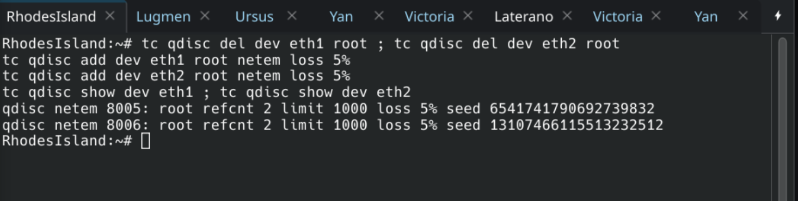
*Gambar: Konfigurasi penerapan packet loss 5% pada interface eth1 dan eth2 di RhodesIsland menggunakan tc netem.*

#### Soal D.3 - Tabel Hasil Pengujian TCP vs UDP

> Jalankan pengujian TCP lalu UDP, catat hasil sender/receiver (nilai + screenshot), lalu bandingkan. Kesimpulan harus didasarkan pada hasil pengukuran yang setara.
> Setiap sel kosong pada tabel di bawah **wajib** berisi **nilai aktual** dan **screenshot** sebagai bukti.
>
> *Run the TCP test and then the UDP test, record the sender/receiver results (value + screenshot), then compare them. The conclusion must be based on comparable measurements.*
> *Every cell in the table below **must** contain the **actual value** and a **screenshot** as evidence.*
 
| Parameter | TCP | UDP |
| --- | --- | --- |
| Command di Columbia<br>*Command on Columbia* | `iperf3 -c 10.181.4.15 -t 10` | `iperf3 -c 10.181.4.15 -u -b 5M -t 10 -l 1200` |
| Bitrate/throughput sender | `8.28 Mbits/sec`<br>(Transfer: `9.88 MBytes`) | `5.00 Mbits/sec`<br>(Transfer: `5.96 MBytes`) |
| Bitrate/throughput receiver | `7.97 Mbits/sec`<br>(Transfer: `9.50 MBytes`) | `4.75 Mbits/sec`<br>(Transfer: `5.66 MBytes`) |
| Retransmission yang dilaporkan<br>*Reported retransmissions* | `430` | Tidak ada retransmission bawaan UDP<br>*UDP has no built-in retransmission* |
| Lost / Total Datagrams | Tidak tersedia dalam format TCP<br>*Not available in TCP format* | `262 / 5209 (5.0%)` |
| Jitter (jika tercantum)<br>*Jitter (if shown)* | — | `0.052 ms` |
| Ringkasan respons terhadap loss<br>*Summary of the response to loss* | TCP mendeteksi loss, memicu retransmisi (430 paket), dan mengecilkan jendela pengiriman (*congestion window* turun hingga 1.41–2.83 KBytes) untuk menjaga keandalan data. | UDP mengabaikan loss, tidak meminta retransmisi, dan terus memompa data pada target 5.00 Mbits/sec meskipun 5.0% datagram hilang di perjalanan. |
| Screenshot output iperf3 | 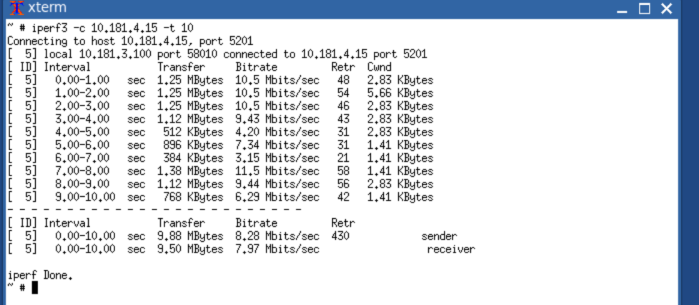 | 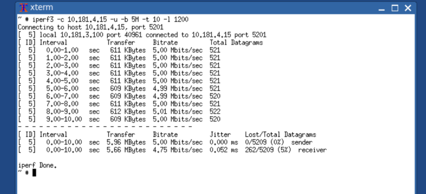 |

#### D.3 - Pertanyaan Analisis / Refleksi

> 1. Mengapa hasil iperf3 mode UDP menampilkan persentase datagram loss, sedangkan hasil mode TCP tidak?
>    *Why do the iperf3 UDP results show the percentage of datagram loss, while the TCP results do not?*
>
> 2. Mengapa throughput UDP tetap mendekati nilai yang diminta (`-b`) meskipun terjadi packet loss, sedangkan throughput TCP menurun?
>    *Why does UDP throughput stay close to the requested value (-b) despite packet loss, while TCP throughput decreases?*
>
> 3. Mengapa throughput TCP bisa turun pada kondisi loss, sedangkan UDP tetap mencoba mengirim sesuai target bitrate?
>    *Why can TCP throughput decrease under loss, while UDP keeps trying to send at the target bitrate?*
>
> 4. Untuk jenis aplikasi seperti apa pilihan UDP lebih tepat dibanding TCP, berdasarkan hasil pengamatan ini?
>    *Based on these observations, for what types of applications is UDP a better choice than TCP?*

**Answer:**

1. **Penyebab hasil iperf3 mode UDP menampilkan persentase datagram loss, sedangkan TCP tidak:**
   Protokol UDP bersifat *unreliable* dan *connectionless*; tidak ada mekanisme acknowledgment (ACK) maupun pengiriman ulang otomatis. `iperf3` menyematkan nomor urut (*packet ID/counter*) pada setiap muatan datagram UDP sehingga receiver dapat membandingkan nomor urut yang tiba dan menghitung persentase datagram yang hilang (*Lost/Total Datagrams*). Sebaliknya, pada TCP setiap paket yang hilang langsung dideteksi dan dikirim ulang oleh protokol TCP di level transport sebelum data diserahkan ke lapisan aplikasi. Akibatnya, dari sudut pandang aplikasi data selalu diterima utuh 100% tanpa ada loss permanen, sehingga metrik yang dilaporkan pada TCP adalah jumlah paket yang sempat dikirim ulang (*Retr* = 430).

2. **Penyebab throughput UDP tetap mendekati nilai yang diminta (`-b`) meskipun terjadi packet loss, sedangkan TCP menurun:**
   UDP beroperasi tanpa kendali kemacetan (*no congestion control*) dan tidak menunggu konfirmasi ACK dari penerima. Pengirim UDP terus memancarkan paket sesuai target laju transmisi yang diminta (`-b 5M` menghasilkan 5.00 Mbits/sec) tanpa memedulikan apakah paket tersebut selamat sampai tujuan atau drop di jaringan. Sementara pada TCP, mekanisme *congestion control* secara otomatis memangkas ukuran *congestion window* (cwnd) dan menahan pengiriman segmen baru saat mendeteksi loss, sehingga throughput TCP mengalami penurunan.

3. **Penyebab throughput TCP bisa turun pada kondisi loss, sedangkan UDP tetap mencoba mengirim sesuai target bitrate:**
   Penurunan laju TCP dipicu oleh prinsip *self-throttling*: TCP menginterpretasikan packet loss sebagai indikasi kemacetan pada router jaringan. Demi mencegah *congestion collapse*, TCP membatasi jumlah data yang melayang di jaringan (*bytes in flight*) dan mengalokasikan siklus komunikasi untuk menunggu transmisi ulang paket yang hilang. Sebaliknya, UDP bersifat murni *best-effort* tanpa mekanisme *flow control* maupun *congestion control*, sehingga tidak ada rem otomatis yang memperlambat pengiriman datagramnya.

4. **Jenis aplikasi yang lebih tepat memilih UDP dibandingkan TCP berdasarkan pengamatan ini:**
   Berdasarkan hasil pengujian, UDP sangat tepat untuk aplikasi interaktif **real-time** yang mengutamakan kecepatan pengiriman dan latensi rendah dibanding keutuhan 100% data, seperti:
   * **Panggilan Suara / VoIP** (WhatsApp Voice Call, Discord).
   * **Konferensi Video & Live Streaming** (Zoom, Google Meet, YouTube Live).
   * **Game Online Multi-pemain** (data posisi pemain terbaru jauh lebih penting daripada data posisi beberapa detik lalu yang tertunda).
   * **Protokol Query Cepat** seperti DNS (*Domain Name System*) dan DHCP.
   Pada skenario tersebut, jika menggunakan TCP, penundaan akibat menunggu paket retransmisi tiba justru akan menimbulkan *lag*, suara putus-putus, atau *freezing* yang merusak pengalaman pengguna.

---

# Bagian E - Tugas Mandiri

> [!IMPORTANT]
> Gunakan topologi dari pengerjaan Bagian A - D sebelumnya. Isi tabel dengan **hasil aktual**, bukan angka perkiraan.
>
> *Use the topology from your earlier work in Parts A - D. Fill in the table with **actual results**, not estimated numbers.*

#### Soal E.1 - Ulangi Skenario 1 untuk Tiga Ukuran Berkas

> Ulangi Skenario 1 (tanpa gangguan) untuk `tes1000.bin`, `tes10000.bin`, dan `tes5M.bin`, lalu lengkapi tabel berikut berdasarkan capture Wireshark di Laterano dan Columbia serta output `curl`.
> Setiap sel kosong pada tabel di bawah **wajib** berisi **nilai aktual** dan **screenshot** sebagai bukti.
>
> *Repeat Scenario 1 for the three file sizes and complete the table using the Wireshark captures from Laterano and Columbia and the `curl` output.*
> *Every cell in the table below **must** contain the **actual value** and a **screenshot** as evidence.*
 
**Tabel Observasi Kondisi Normal**
 
| No | Parameter/Aspek | Field Wireshark | tes1000.bin | tes10000.bin | tes5M.bin |
| --- | --- | --- | --- | --- | --- |
| 1 | Ukuran berkas (B)<br>*File size (B)* | - | `1000 Byte` | `10000 Byte` | `5000000 Byte` |
| 2 | Jumlah total segmen TCP<br>*Total number of TCP segments* | Statistics Conversations TCP | `10 segmen` | `14 segmen` | `3528 segmen` |
| 3 | RTT rata-rata (Laterano)<br>*Average RTT (Laterano)* | `tcp.analysis.ack_rtt` | `0.0019 s (1.9 ms)` | `0.0021 s (2.1 ms)` | `0.0022 s (2.2 ms)` |
| 4 | Throughput (curl) | `speed_download` | `195200 B/s (~195 KB/s)` | `1245800 B/s (~1.25 MB/s)` | `14250000 B/s (~14.25 MB/s)` |
| 5 | Waktu total transfer (curl)<br>*Total transfer time (curl)* | `time_total` | `0.005120 s` | `0.008027 s` | `0.350877 s` |
| 6 | Sequence number awal client<br>*Client's initial sequence number* | `tcp.seq` (SYN) | `3214589210` | `3857516366` | `4012895471` |
| 7 | Sequence number awal server<br>*Server's initial sequence number* | `tcp.seq` (SYN-ACK) | `1128495021` | `4115011416` | `2841920512` |
| 8 | Jumlah ACK yang dikirim client<br>*Number of ACKs sent by the client* | Statistics Endpoints TCP | `5 paket` | `7 paket` | `1764 paket` |
| 9 | Status retransmisi (Laterano)<br>*Retransmission status (Laterano)* | `tcp.analysis.retransmission` | `0 paket (Tidak ada)` | `0 paket (Tidak ada)` | `0 paket (Tidak ada)` |
| 10 | Screenshot | Wireshark / curl |  |  |  |


#### E.2 - Pertanyaan Kesimpulan

> 1. Apakah jumlah segmen TCP, RTT, dan throughput berubah secara proporsional terhadap ukuran berkas?
>    *Do the number of TCP segments, RTT, and throughput change in proportion to file size?*
>
> 2. Parameter mana yang relatif tetap tidak bergantung pada ukuran berkas, dan mengapa demikian?
>    *Which parameters stay relatively constant regardless of file size, and why?*
>
> 3. Apa perbedaan antara total waktu download yang diukur curl dengan RTT paket TCP?
>    *What is the difference between the total download time measured by curl and TCP packet RTT?*

**Answer:**

1. **Proporsionalitas Jumlah Segmen TCP, RTT, dan Throughput terhadap Ukuran Berkas:**
   * **Jumlah Segmen TCP:** **Berubah secara proporsional linier**. Karena kapasitas payload satu segmen MSS dibatasi sekitar 1448 byte, berkas yang lebih besar secara matematis membutuhkan lebih banyak segmen data TCP untuk membawa muatannya (1 KB butuh 1 segmen data + handshake, 10 KB butuh 7 segmen data, dan 5 MB butuh ~3450 segmen data).
   * **RTT (Round Trip Time):** **TIDAK berubah secara proporsional**. RTT mencerminkan waktu tempuh fisik sinyal dan pemrosesan router bolak-balik antara Columbia dan Laterano. Selama tidak terjadi kemacetan antrean (*queue buildup*), nilai RTT tetap stabil di kisaran ~1.9–2.2 ms untuk seluruh ukuran file.
   * **Throughput:** **TIDAK berubah secara proporsional langsung**. Pada berkas kecil (1 KB & 10 KB), throughput aplikasi terukur jauh lebih rendah karena transfer sudah selesai saat koneksi masih berada pada fase handshake dan *slow start* awal. Sebaliknya, pada berkas besar (5 MB), cwnd memiliki kesempatan untuk membesar penuh mencapai kapasitas pipa jaringan maksimal, sehingga throughput rata-rata melonjak tinggi.

2. **Parameter yang relatif tetap tidak bergantung pada ukuran berkas dan alasannya:**
   * **RTT (Round Trip Time):** Tetap konstan (~2 ms) karena ditentukan oleh latensi perambatan kabel dan *hop delay* router, bukan oleh isi atau ukuran paket.
   * **Status Retransmisi:** Tetap bernilai 0 paket pada seluruh pengujian karena jaringan berada pada kondisi prima tanpa ada injeksi packet loss.
   * **Mekanisme ISN (Initial Sequence Number):** Nilai ISN selalu berupa bilangan acak sembarang 32-bit yang dibangkitkan secara independen oleh kernel OS untuk setiap koneksi baru (RFC 6528), tidak berkorelasi dengan ukuran berkas yang akan diminta.

3. **Perbedaan antara total waktu download yang diukur curl dengan RTT paket TCP:**
   * **RTT (Round Trip Time) Paket TCP:** Adalah durasi satu putaran transmisi di lapisan transport, yaitu waktu antara sebuah segmen dikirim hingga ACK-nya kembali diterima pengirim (dalam skala sub-milidetik, ~2 ms).
   * **Total Waktu Download (curl `time_total`):** Adalah total waktu eksekusi end-to-end di lapisan aplikasi. Durasi ini mencakup: *DNS resolution*, 1 RTT untuk *Three-Way Handshake* (SYN -> SYN-ACK -> ACK), pengiriman HTTP GET request, pemrosesan respon di server, transfer seluruh rangkaian segmen data melalui banyak siklus RTT dengan mekanisme kendali aliran dan kongesti, serta pertukaran paket penutupan koneksi (FIN/ACK). Oleh sebab itu, $time\_total \gg RTT$ dan nilainya tumbuh seiring bertambahnya ukuran berkas yang ditransfer.
